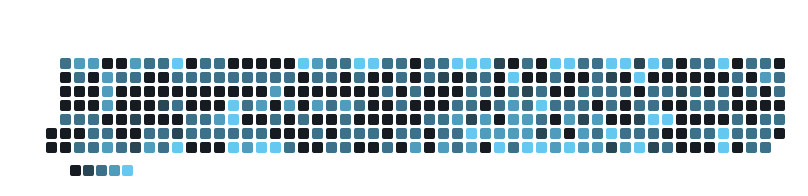
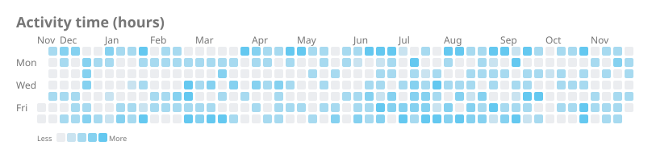

# Activity heatmap

A GitHub-style calendar showing daily timer-active physical activity time.




The heatmap is generated from Garmin FIT files downloaded from Intervals.icu
and a private historical activity dataset. This repository contains the complete,
reproducible processing pipeline; personal activity records remain in a separate
private repository.

## What the heatmap shows

Each square represents one calendar day. Its intensity reflects the sum of
activity moving time on that day. Multiple activities are aggregated together.

- The metric is FIT session `total_timer_time` (seconds), excluding paused time.
- All supported Garmin activity types are included, not only running.
- Historical records and FIT activities are summed by Europe/Rome calendar date.
- The displayed range is a rolling 365-calendar-day window.
- The SVG is rendered with [Quilt](https://github.com/StheBerga/quilt), using
  the project-owned five-color palette and fixed 0.5-hour intensity steps.

## Project-owned palette

The activity heatmap defines its own five-color palette in
[`python/activity_palette.py`](python/activity_palette.py). The colors are
registered with Quilt's documented Python API at render time. Quilt remains a
standalone package with its own built-in themes; this repository does not fork,
patch, or overwrite Quilt's source code.

The file defines two project-owned palettes: `stheberga-light` and
`stheberga-dark`. Each contains five colors, ordered from no activity to
highest activity. The default palette is `stheberga-dark`.

The scheduled workflow selects its palette through the `--theme` argument.
Change this to `stheberga-light` to use the light version.

## Architecture

The public repository contains the R processing code, Python Intervals.icu
client, SVG renderer, tests, and GitHub Actions workflows. The workflow also
exports the same daily moving-time summary as a versioned JSON file to the
private data repository.

At production time, GitHub Actions checks out the historical CSV from the
private [running-heatmap-data](https://github.com/StheBerga/running-heatmap-data)
repository. It downloads the required original FIT files from Intervals.icu
into temporary runner storage, builds one daily moving-time summary, and uses
that same summary for both outputs: the light/dark SVG heatmaps are published
here, while the versioned JSON is published to the private data repository.

See [the architecture and privacy notes](docs/ARCHITECTURE.md) and the
[JSON data contract](docs/JSON_DATA.md) for details.

## Repository secrets

Configure these Actions secrets in this public repository:

| Secret | Purpose |
| --- | --- |
| `INTERVALS_API_KEY` | Personal Intervals.icu API key with access to activity files |
| `HEATMAP_DATA_READ_TOKEN` | Fine-grained GitHub token with **Contents: read** access to `StheBerga/running-heatmap-data` only |
| `HEATMAP_DATA_WRITE_TOKEN` | Fine-grained GitHub token with **Contents: read and write** access to `StheBerga/running-heatmap-data` only; used only to publish `data/activity_data.json` |

The workflow uses its automatically provided `GITHUB_TOKEN` to update the SVG
in this repository. The separate `HEATMAP_DATA_WRITE_TOKEN` is used only for
the JSON commit to the private data repository.

## Local development

Install Python dependencies and run the Python helper tests:

```bash
python -m pip install -r python/requirements.txt
python -m unittest discover -s python -p 'test_*.py' -v
```

R aggregation and JSON export test (requires R and jsonlite):

```bash
Rscript -e 'install.packages("jsonlite")'
Rscript tests/test_process_activities.R
```

The full production pipeline additionally requires the R package `FITfileR`,
a private historical CSV, and an Intervals.icu API key. Never commit FIT files,
personal activity-level records, API keys, or generated intermediate CSVs to
this repository.

## Privacy

The public SVGs reveal the dates on which activity occurred and the relative
daily moving-time totals. Raw FIT files can contain GPS tracks, timestamps,
heart-rate data, and device information; they are not published here. The
historical CSV, generated daily JSON, and all intermediate activity data
remain private.
