# Running heatmap

A GitHub-style calendar of my running activity, generated automatically from Garmin FIT files.

The image is regenerated from the private source repository. Only the rendered SVG is published here; the original FIT files and intermediate activity data remain private.

The heatmap covers a rolling 365-day window. Each active day is coloured according to its total running distance relative to the busiest day in that window.

